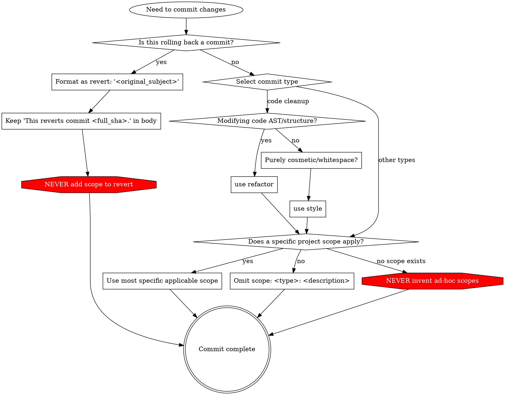

# Conventional Commits

## Overview

Format git commits using the Conventional Commits specification: `<type>(<scope>): <description>`. Every commit must clearly communicate its intent, impact, and semantic meaning through standardized types and precise scoping.

## When to Use

- Writing any git commit message
- Structuring automated release and changelog-friendly history
- Reverting a previous commit
- Categorizing changes between behavioral, structural, and cosmetic modifications

When NOT to use:
- Projects with a conflicting, explicitly documented commit convention (e.g., Git heritage format or ticket-only prefixes like `[PROJ-1234]`).

## Format Specification

```
<type>(<scope>): <description>

[optional body]

[optional footer(s)]
```

- **Header:**
  - `<type>`: Lowercase identifier indicating the category of change.
  - `(<scope>)`: Context indicating the affected component or package. Omitted if no specific scope applies; **never** used on `revert`.
  - `<description>`: Imperative, present-tense summary (e.g., "add", "fix", "update", not "added" or "adds"). Lowercase, no trailing period.
- **Body:** Explains the motivation for the change and contrasts it with previous behavior.
- **Breaking Changes:** Indicated by a `!` before the colon in the header (e.g., `feat(api)!: drop v1 endpoints`) or a `BREAKING CHANGE:` footer.

## Valid Commit Types

| Type | Purpose | Production Code Impact |
|------|---------|------------------------|
| `feat` | New feature or functionality for users/consumers | Yes |
| `fix` | Bug fixes addressing incorrect behavior in production code | Yes |
| `perf` | Code changes that improve measurable performance | Yes |
| `refactor` | Structural improvements to code without changing behavior or public semantics | Yes |
| `style` | Cosmetic/superficial changes (whitespace, formatting, semicolons) that do not affect code structure or semantics | No |
| `test` | Adding, modifying, fixing, or improving tests | No |
| `docs` | Changes to documentation, docstrings, or API descriptions | No |
| `build` | Changes impacting build configuration, packaging, tooling, or production runtime dependencies | Yes / Build |
| `chore` | Administrative, tooling, or supportive maintenance tasks that do not impact production code | No |
| `revert` | Rolling back a previous commit | Varies |

### Refactor vs. Style

The boundary between `refactor` and `style` is absolute:
- **`refactor`** modifies the Abstract Syntax Tree (AST), logic, structure, or organization of the code (e.g., extracting functions, simplifying conditionals into guard clauses, renaming symbols across references) without altering external behavior.
- **`style`** is purely superficial and has zero effect on code structure, AST, semantics, or functionality (e.g., fixing indentation, line breaks, whitespace, semicolons, formatting).

> [!IMPORTANT]
> Never mislabel a `refactor` as `style` or `chore` to bypass release tooling or changelog generators. Maintain semantic truth in the version history; configure release tooling to handle categories appropriately.

## Scope Rules

Projects define valid scopes based on their architecture (e.g., packages in a monorepo, architectural layers, or functional domains). Follow these universal principles:

1. **Mandatory When Applicable:** If a documented or applicable scope exists for the affected code, it **MUST** be used—except for `revert`, which never takes a scope.
2. **Omit When Inapplicable:** If no valid scope applies (e.g., repository-wide root files, multi-component refactors), the scope **MUST** be omitted: `<type>: <description>`. **Never** invent synthetic scopes (e.g., `repo`, `root`, `misc`, `all`).
3. **Specificity Over Generality:** If multiple scopes could apply, select the most specific one that is accurate.
4. **Judge by What the Change Serves:** Select the scope based on the consumer/service that the change serves, not incidental file location.
   - *Example:* A third-party dependency imported exclusively by `service-auth` takes scope `service-auth` (e.g., `build(service-auth): update pyjwt to v2.8.0`), not a generic `deps` scope.
   - *Example:* A universal dependency (like a test runner or root linter) that serves the entire repository takes `deps` (or no scope if `deps` is not a defined scope).

## Reverting Commits

Git's default revert behavior creates commits that violate Conventional Commits. You must format revert commits deliberately:

```markdown
revert: "<commit_message_of_reverted_commit>"

This reverts commit <full_sha>.
```

### Strict Revert Requirements

1. **Exact Subject Format:** Must use `revert: "<original_subject>"`. The original commit subject must be enclosed in quotes.
2. **Never Add a Scope to Revert:** The `revert` type **MUST NOT** include a scope of its own.
   - **Correct:** `revert: "feat(checkout): add Apple Pay support"`
   - **Incorrect:** `revert(checkout): "feat(checkout): add Apple Pay support"`
   - **Incorrect:** `revert(checkout): rollback Apple Pay support`
3. **Retain the Git Revert Body:** The body **MUST** keep Git's `This reverts commit <full_sha>.` line. A quoted subject alone is not sufficient to identify the exact commit hash being reverted.
4. **Edit Git's Default Message:** Because `git revert` writes `Revert "<subject>"` by default, the subject always requires editing:
   - Use `git revert --edit <sha>`, or amend immediately: `git revert --no-edit <sha> && git commit --amend -m 'revert: "<original_subject>"'` (preserving the body).

## Decision Flowchart



## Red Flags - STOP and Correct

- Leaving Git's default `Revert "<subject>"` header unchanged.
- Adding a scope to `revert` (e.g., `revert(scope): "..."`).
- Stripping `This reverts commit <full_sha>.` from the commit body.
- Calling code refactoring `style` or `chore` because "it doesn't add features" or "to avoid changelog entries".
- Calling cosmetic formatting or whitespace changes `refactor`.
- Inventing synthetic scopes like `(root)`, `(repo)`, or `(all)` when no scope applies.
- Using a generic scope (like `deps`) when a dependency exclusively serves a specific component scope.

## Rationalization Table

| Excuse | Reality |
|--------|---------|
| "Git generates `Revert \"...\"` by default so I shouldn't change it" | Git's default is not Conventional Commits compliant. Edit the subject to `revert: \"<subject>\"`. |
| "A revert needs a scope so changelogs categorize it under the affected component" | The original commit subject inside quotes already carries the scope and context. `revert` never takes its own scope. |
| "I'm in an emergency incident, so commit message format doesn't matter" | Clean history matters most during incidents. Post-incident audits and automated tools depend on accurate commit metadata. |
| "Labeling this as `refactor` creates noisy release notes; I'll use `style` instead" | Never falsify commit semantics to work around release tooling. Configure release filters to manage changelog output. |
| "This dependency is in the root config, so its scope is `deps`" | Scope reflects what the change *serves*. If only one service uses the dependency, scope it to that service. |
| "My linter requires parentheses, so I'll invent `(repo)` or `(root)`" | Valid scopes are whitelisted. Inventing arbitrary scopes violates `scope-enum`. Omit the scope entirely when none applies. |
